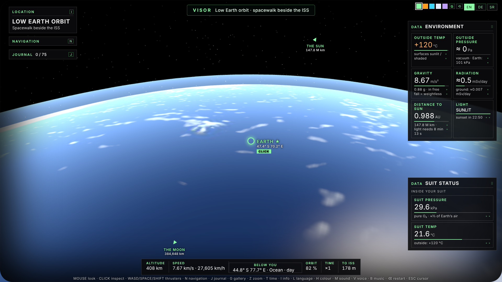
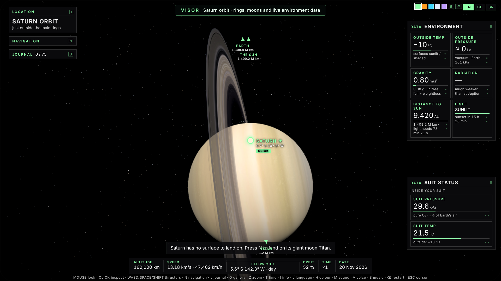
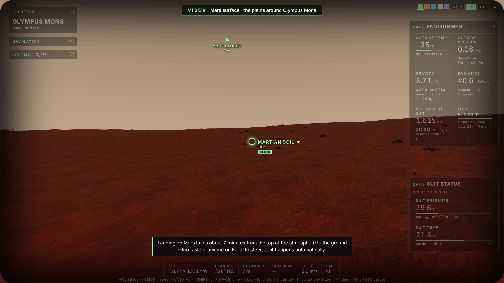
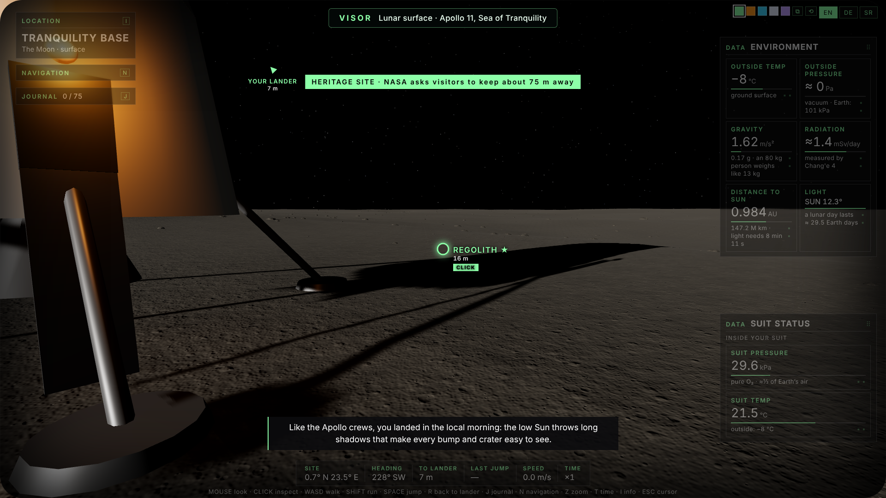
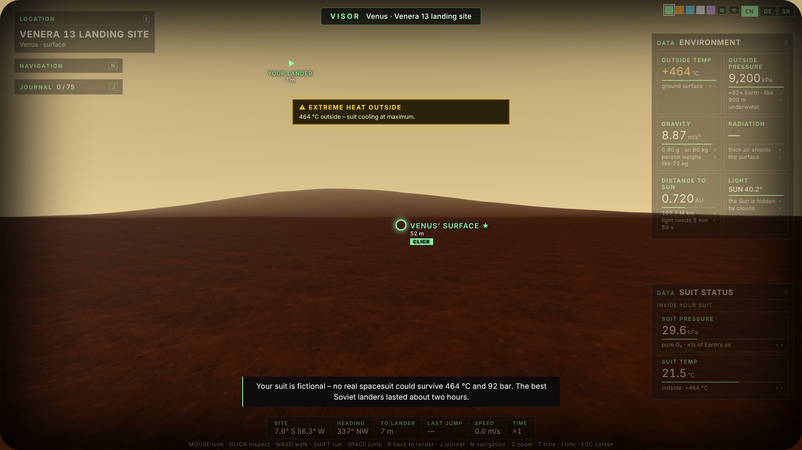
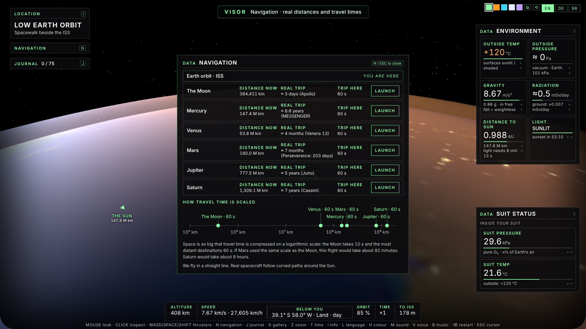

# VISOR

**A walk through the Solar System, seen through the visor of your spacesuit.**

VISOR is a free, offline, single-file space explorer. You start on a spacewalk beside the International Space Station, then fly to the Moon and the planets, land at real landing sites and learn what you are looking at by clicking on it. Every number on the HUD is based on real data from NASA and ESA.

## Play

1. Download `visor.html` from the [latest release](../../releases/latest).
2. Open it in a desktop browser (Chrome, Edge or Firefox recommended).
3. Click **Start** and put on headphones.

No install and no account. Everything runs in your browser, offline. Only the NASA picture gallery needs an internet connection.

## What you can do

- **Fly anywhere.** Travel from Earth orbit to the Moon, Mercury, Venus, Mars, Jupiter and Saturn. Each trip takes one minute. The navigation map shows the real distances and how long real missions took.
- **Land at 12 real sites.** Apollo 11 and Apollo 17, the lunar south pole, Jezero, Gale Crater and Olympus Mons on Mars, Caloris and Prokofiev on Mercury, Venera 13 and Maat Mons on Venus, Conamara Chaos on Europa and the Huygens site on Titan. You can also ride the Galileo probe into Jupiter's clouds.
- **Click to learn.** Planets, moons, rocks, spacecraft and landmarks open short info cards with sources. Everything you find goes into your discovery journal (75 entries).
- **Read your suit.** Live readings for temperature, pressure, gravity, radiation, sunlight and distance to the Sun. Yellow alerts warn you when a place would be deadly for a real astronaut.
- **Listen to your guide.** A calm narrator welcomes you, counts down each departure and shares facts about the route and the destination during the flight. She speaks English; subtitles are always shown in your chosen language.
- **Relax to the music.** Soft, planetarium-style background music is generated live in your browser and changes with the scene.
- **Learn on the way.** During each flight you get travel tips, a trip log and a short, plain-language look at how relativity would affect a real journey.
- **Browse NASA pictures.** A curated gallery of real mission images for every destination.
- **Make the HUD yours.** Drag any window by its title bar. Windows snap to a grid and stay where you put them. Five colour themes.
- **Three languages.** English, German and Serbian (Latin script), switchable at any time.

## Controls

| Key | In space | On the surface |
|---|---|---|
| Mouse | Look around | Look around |
| Click | Inspect an object | Inspect an object |
| W A S D | Thrusters | Walk |
| Space / Shift | Up / down | Jump / run |
| N | Navigation (choose a destination) | Navigation |
| R | – | Back to your lander |
| J | Discovery journal | Discovery journal |
| G | NASA picture gallery | NASA picture gallery |
| I | Info about where you are | Info about where you are |
| Z | Zoom | Zoom |
| T | Speed up time | Speed up time |
| L | Change language | Change language |
| H | Change colour theme | Change colour theme |
| Shift + H | Reset window layout | Reset window layout |
| M / V / B | Sound / voice / music on or off | Sound / voice / music on or off |
| Backspace | Return to the ISS (asks first) | Return to the ISS (asks first) |
| C | Credits and sources | Credits and sources |
| Esc | Free the mouse cursor | Free the mouse cursor |

## Screenshots

| | |
|---|---|
|  |  |
| Saturn orbit | The plains around Olympus Mons |
|  |  |
| Apollo 11, Sea of Tranquility | Venera 13 landing site on Venus |
|  | |
| Navigation with real distances and travel times | |

## How real is it?

The data is real: gravity, temperatures, radiation, distances, light travel times and the positions of the Sun, Moon and planets (from JPL orbital elements, accurate to a fraction of a degree).

Some things are simplified so the game stays playable:

- Travel time is compressed on a logarithmic scale. Every trip takes one minute.
- Ships fly in straight lines instead of curved transfer orbits.
- Terrain is generated in code. Real landmarks are placed approximately, and distances at landing sites are shortened.
- Your spacesuit is fictional. On Venus, for example, no real suit would survive.

## Requirements

- A desktop browser with WebGL (any recent Chrome, Edge, Firefox or Safari).
- Mouse and keyboard.
- About 9 MB of disk space.

The recorded narrator voice uses the Opus audio format. If your browser can't play it (some older Safari versions), you still get the subtitles.

## Credits and sources

- **Facts and figures:** NASA (science.nasa.gov, NSSDC fact sheets, JSC) and ESA. Each info card lists its own sources.
- **Earth and Moon textures:** three.js example textures (MIT), based on NASA Blue Marble and lunar maps.
- **Mars, Mercury, Venus, Jupiter and Saturn textures:** [Solar System Scope](https://www.solarsystemscope.com/textures/) (CC BY 4.0), based on NASA data. Europa and Titan are generated in code.
- **Planet positions:** JPL Keplerian elements and the IAU rotation model for Mars.
- **Gallery images:** NASA/JPL-Caltech and partner missions, loaded from NASA's servers.
- **Narrator voice:** [Kokoro-82M](https://huggingface.co/hexgrad/Kokoro-82M) (Apache 2.0), voice bf_emma, generated offline.
- **3D engine:** [three.js](https://threejs.org) (MIT).
- **Sound effects and music:** synthesised live in the browser.

## License

The VISOR code is released under the [MIT License](LICENSE). The textures and images above keep their own licences.
